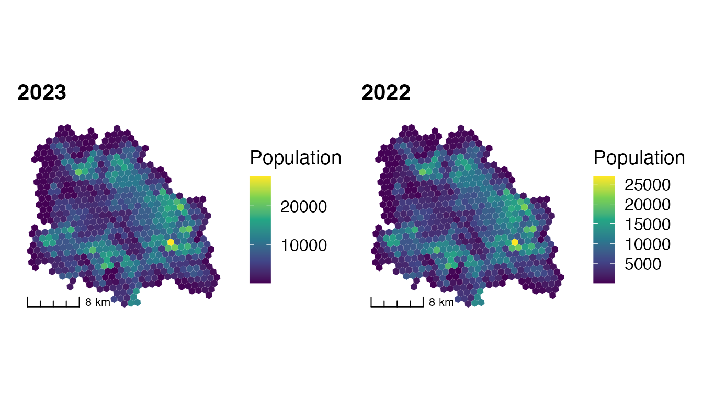
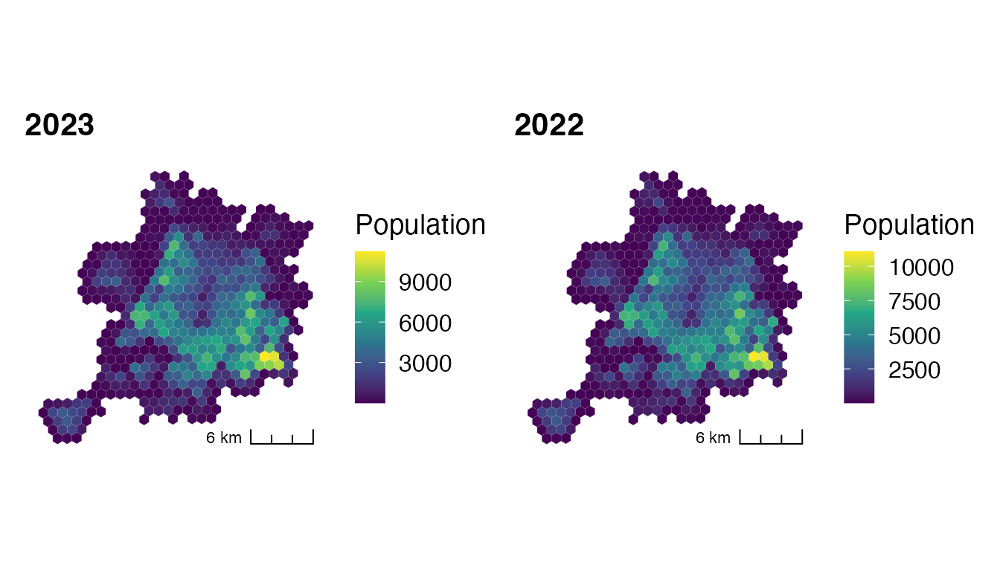

# Extract and Visualize the Population of an Urban City

``` r

library(popmex)
```

The visualization of the population of an urban city is carried out in
two steps: first the population of the urban locality is extracted with
[`extract_pop()`](https://fdzul.github.io/popmex/reference/extract_pop.md),
and then it is mapped.

## Population of the metropolitan area of Guadalajara

### Extract the population

``` r

gdl <- c("Guadalajara", "Tlaquepaque", "Zapopan", "Tonalá")

x <- popmex::extract_pop(year = 2023, cve_edo = "14", locality = gdl)
y <- popmex::extract_pop(year = 2022, cve_edo = "14", locality = gdl)

# total population in each year
c("2023" = sum(x$population), "2022" = sum(y$population))
#>    2023    2022 
#> 3734639 3642208
```

### Static map

``` r

pop_map <- function(data, title, location = "bl") {
    ggplot2::ggplot() +
        ggplot2::geom_sf(data = data,
                         ggplot2::aes(fill = population),
                         col = "white",
                         lwd = 0.01) +
        ggplot2::scale_fill_viridis_c("Population") +
        ggplot2::labs(title = title) +
        cowplot::theme_map() +
        ggspatial::annotation_scale(style = "ticks", location = location)
}

library(patchwork)
pop_map(x, "2023") | pop_map(y, "2022")
```



### Interactive map

``` r

a <- mapview::mapview(x, zcol = "population", layer.name = "Population 2023")
b <- mapview::mapview(y, zcol = "population", layer.name = "Population 2022")
leafsync::sync(a, b)
```

## Population of the metropolitan area of Mérida

### Extract the population

``` r

mid <- c("Merida", "Uman", "Kanasin", "Caucel", "Cholul")

x <- popmex::extract_pop(year = 2023, cve_edo = "31", locality = mid)
y <- popmex::extract_pop(year = 2022, cve_edo = "31", locality = mid)

c("2023" = sum(x$population), "2022" = sum(y$population))
#>    2023    2022 
#> 1066473 1032469
```

### Static map

``` r

pop_map(x, "2023", location = "br") | pop_map(y, "2022", location = "br")
```



### Interactive map

``` r

a <- mapview::mapview(x, zcol = "population", layer.name = "Population 2023")
b <- mapview::mapview(y, zcol = "population", layer.name = "Population 2022")
leafsync::sync(a, b)
```

## Population by municipality

The census datasets (`pop2000`, `pop2010`, `pop2020`) and the CONAPO
projections (`conapop`) give the population of each municipality, which
is the usual denominator of incidence rates.

``` r

# five most populated municipalities in 2020
head(pop2020[order(-pop2020$pobtot), c("CVEGEO", "pobtot", "pobfem", "pobmas")], 5)
#> # A tibble: 5 × 4
#>   CVEGEO  pobtot pobfem pobmas
#>   <chr>    <dbl>  <dbl>  <dbl>
#> 1 02004  1922523 953783 968740
#> 2 09007  1835486 947835 887651
#> 3 11020  1721215 874542 846673
#> 4 21114  1692181 882696 809485
#> 5 15033  1645352 846803 798549

# CONAPO projection for Mérida (31050) in 2026, both sexes
sum(conapop$pob_total[conapop$cvegeo == "31050" & conapop$ano == 2026])
#> [1] 1102068
```
